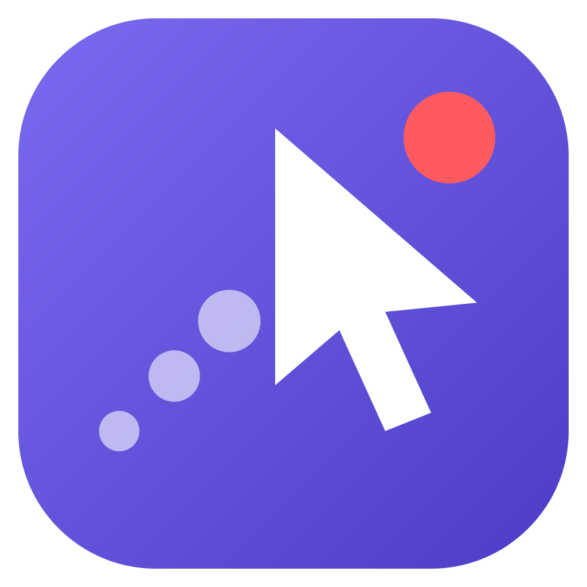
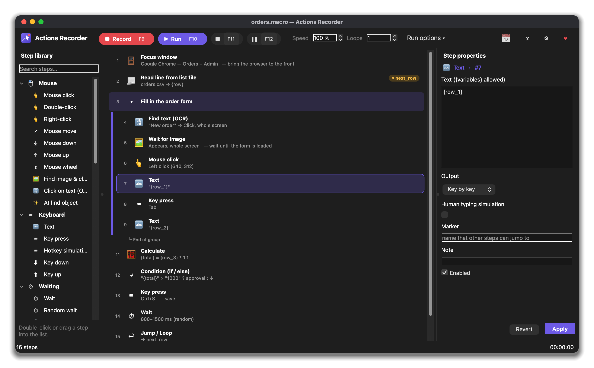
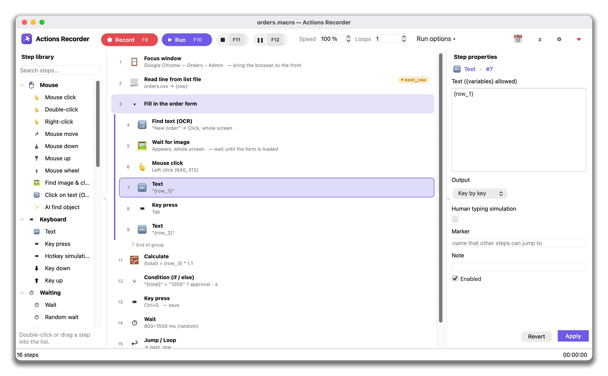
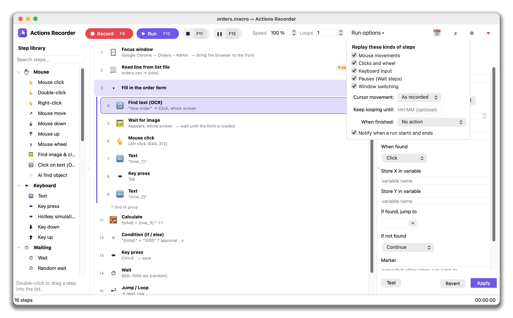
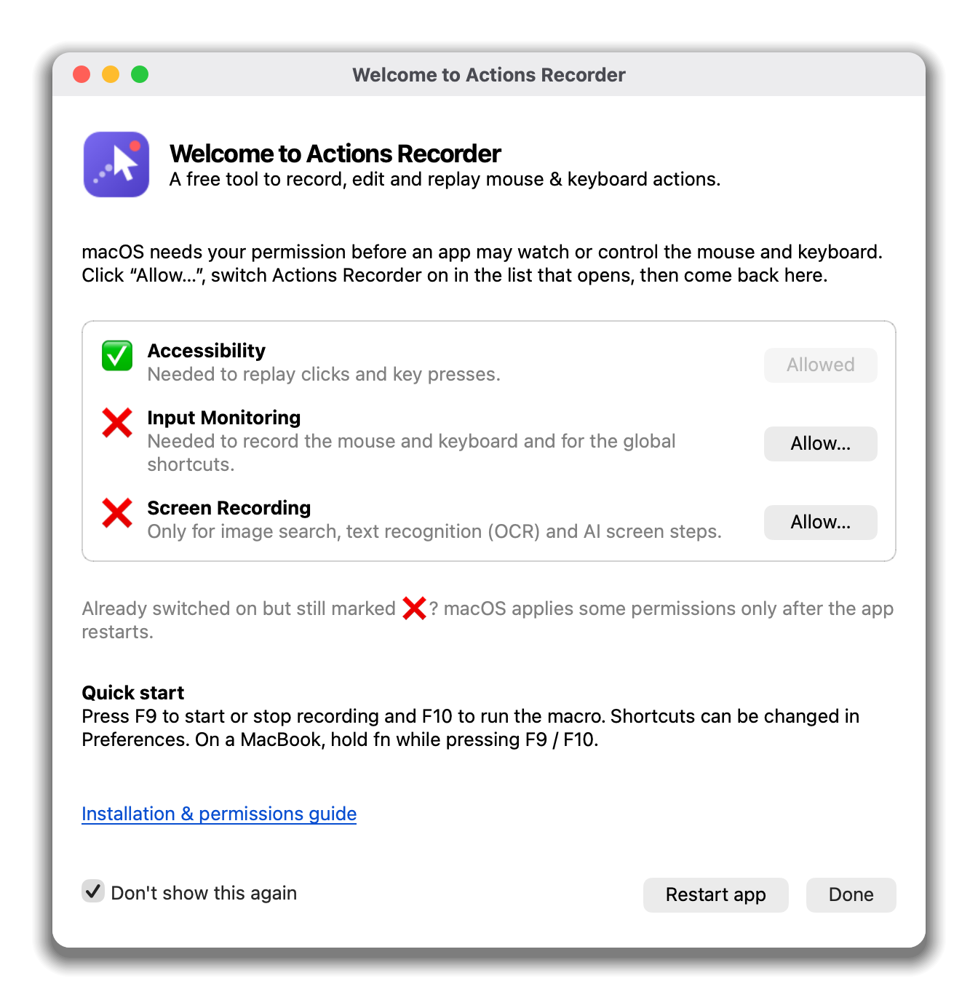
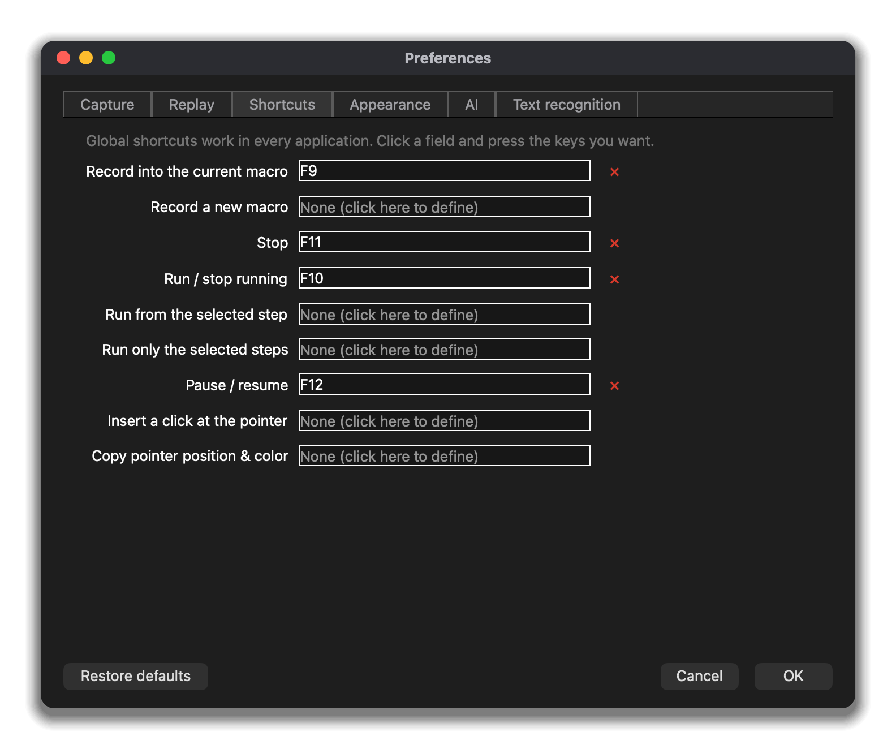

<p align="center"></p>

# Actions Recorder

**English** · [Tiếng Việt](README.vi.md)

A **free and open-source** tool to record, edit and replay mouse & keyboard actions on **Windows** and **macOS**.
Capture what you do once, fine-tune the steps, then let them run for you — with image search, text recognition
(OCR), variables, conditions, loops, a scheduler and optional AI steps.

<p align="center"></p>

## Download

**[⬇ Download the latest release](https://github.com/duyluonglc/actions-recorder/releases/latest)** — Windows (`.zip`),
Mac with Apple chip and Mac with Intel (`.dmg`).

The app is not signed with paid certificates, so Windows / macOS show a warning the first time, and macOS needs
a few permissions. 👉 **Read the [installation & permissions guide](docs/INSTALL.md)** — it takes a minute.

## Support ❤

Actions Recorder is free for everyone. If it saves you time, you can support its development:

[](https://paypal.me/luongnd/5USD) [](https://paypal.me/luongnd/10USD) [](https://paypal.me/luongnd) [](https://github.com/sponsors/duyluonglc)

Or simply ⭐ star the repository and tell a friend. Thank you!

## Features

- **Record** mouse paths, clicks, double-clicks, drags, the wheel, typing (merged into Text steps), key
  combinations and window switches. Pauses become *Wait* steps.
- **Edit** in a three-pane workspace: step library (search, double-click or drag), step list (groups, markers,
  notes, on/off per step, drag to reorder), and a properties panel with a **Test** button.
- **Run** with adjustable speed, loops (count, forever, or until a time of day), from the selected step or only
  the selected steps, pause/resume, and an action when finished (lock, sleep, shut down …).
- **Steps** for the mouse, keyboard, waiting (time, random, image, text, pixel colour, screen change, file,
  window), screen & OCR (find image / text and click, capture text, screenshots, barcodes & QR codes),
  data (variables, calculations, CSV lists, saving to files, reading web pages), flow (jump / loop, if / else,
  run another macro, launch programs, focus windows, message boxes, notifications) and **AI**
  (prompts, screen analysis, find an object by description — OpenRouter, OpenAI, or local Ollama / LM Studio).
- **Target window**: make a macro work inside one application window. The window is brought to the front
  automatically and positions are measured from its top-left corner, so the macro keeps working when the window
  moves or sits on another monitor. Pick the window right from the **Record** button (or *Record in a window…*) to record directly in window coordinates.
- **Record only what will be replayed** – optionally leave out step types that are turned off in *Run options* (e.g. mouse movements or pauses).
- **Launch app & wait for window**: start a program and continue only when its window has appeared.
- **Multiple monitors**: recording, replay, image search and OCR work across all screens (including screens left
  of or above the main one), with per-monitor scaling on Windows.
- **Global shortcuts**: F9 record, F10 run, F11 stop, F12 pause (configurable), shown on the buttons.
- **Scheduler**, variable explorer, tray icon, command line (`--play`), launcher files, CSV export,
  English & Vietnamese UI, light & dark themes.

## Screenshots

<table><tr><td align="center" width="50%"><a href="docs/screenshots/main-en-light.png"></a><br><sub>Light theme: step library, step list and properties</sub></td><td align="center" width="50%"><a href="docs/screenshots/run-options-en-light.png"></a><br><sub>Run options: which steps to replay, cursor movement, looping</sub></td></tr><tr><td align="center" width="50%"><a href="docs/screenshots/setup-en-light.png"></a><br><sub>First launch on macOS: permissions with live status</sub></td><td align="center" width="50%"><a href="docs/screenshots/preferences-en-dark.png"></a><br><sub>Preferences: global shortcuts F9–F12, all configurable</sub></td></tr></table>

## Privacy

Macros, settings and screenshots stay on your computer. Nothing is sent anywhere except the content of an
AI step you add yourself, to the AI provider you configure (or to a local model).

## Run from source

```bash
git clone https://github.com/duyluonglc/actions-recorder.git
cd actions-recorder
python3 -m venv .venv
.venv/bin/pip install -r requirements.txt        # Windows: .venv\Scripts\pip ...
.venv/bin/python run.py                          # GUI
.venv/bin/python run.py --play my.macro          # headless replay (Esc stops)
.venv/bin/python -m unittest discover -s tests   # tests
```

## Build

- **macOS:** `./build_macos.sh` → `dist/ActionsRecorder-<version>-macOS-<AppleSilicon|Intel>.dmg`
- **Windows:** `build_windows.bat` → `dist\ActionsRecorder-<version>-Windows-x64.zip`
- **GitHub Actions** builds all three on every push. Push a tag such as `v2.0.0` to publish a Release with the
  downloads attached.

## License

[MIT](LICENSE) © Luong Nguyen — free for any use, including commercial, as long as the copyright notice is kept.
