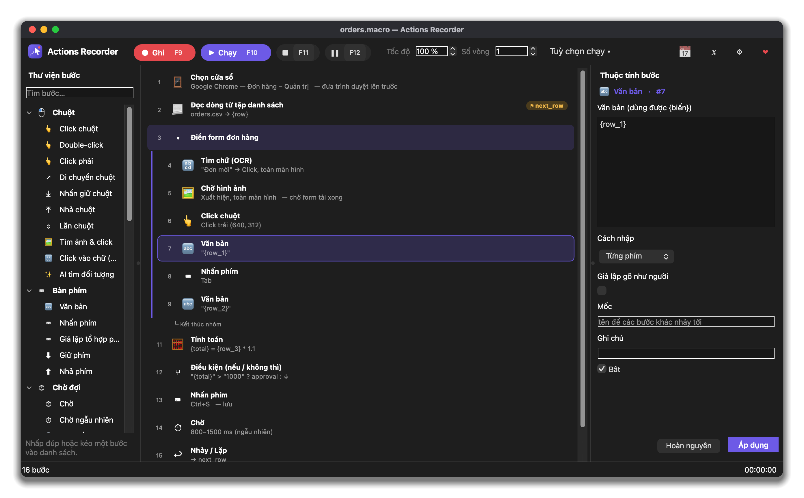
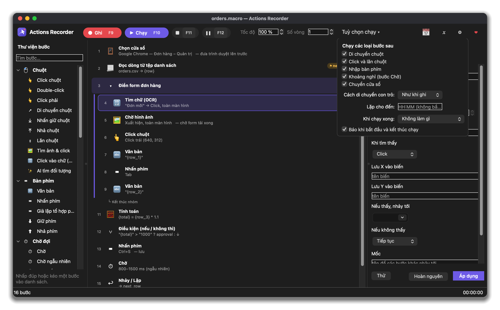
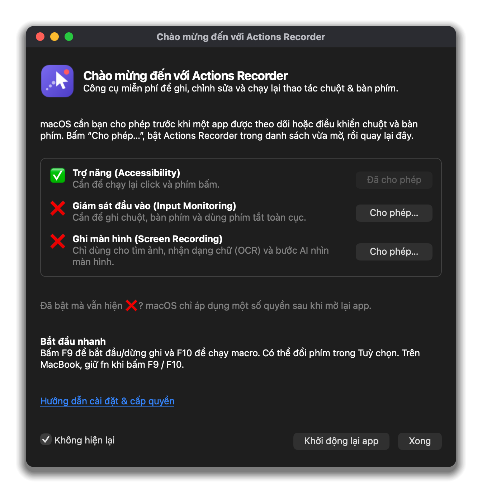
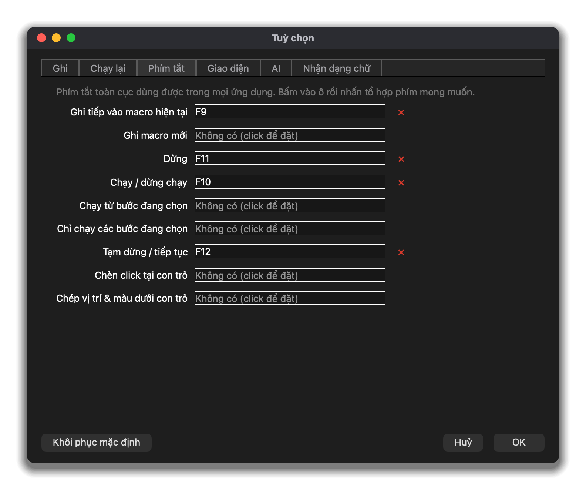

<p align="center"></p>

# Actions Recorder

[English](README.md) · **Tiếng Việt**

Ứng dụng **miễn phí, mã nguồn mở** để ghi, chỉnh sửa và chạy lại macro chuột & bàn phím trên **Windows** và **macOS**. Giao diện tiếng Việt và tiếng Anh.

<p align="center"></p>

## Tải về

**[⬇ Tải bản mới nhất](https://github.com/duyluonglc/actions-recorder/releases/latest)** — Windows (`.zip`), Mac chip Apple và Mac Intel (`.dmg`).

App không ký bằng chứng chỉ trả phí nên lần mở đầu Windows / macOS sẽ cảnh báo, và macOS cần cấp quyền.
👉 **Xem [hướng dẫn cài đặt & cấp quyền](docs/INSTALL.vi.md)** (chỉ mất một phút).

## Ủng hộ ❤

Actions Recorder miễn phí cho mọi người. Nếu app giúp bạn tiết kiệm thời gian, bạn có thể ủng hộ để dự án được duy trì:

[](https://paypal.me/luongnd/5USD) [](https://paypal.me/luongnd/10USD) [](https://paypal.me/luongnd) [](https://github.com/sponsors/duyluonglc)

Hoặc đơn giản là ⭐ star repo và giới thiệu cho bạn bè. Cảm ơn bạn!

## Ảnh chụp màn hình

<table><tr><td align="center" width="50%"><a href="docs/screenshots/run-options-vi-dark.png"></a><br><sub>Tuỳ chọn chạy: loại bước, cách di chuyển con trỏ, lặp</sub></td><td align="center" width="50%"><a href="docs/screenshots/setup-vi-dark.png"></a><br><sub>Mở lần đầu trên macOS: cấp quyền, trạng thái cập nhật trực tiếp</sub></td></tr><tr><td align="center" width="50%"><a href="docs/screenshots/preferences-vi-dark.png"></a><br><sub>Tuỳ chọn: phím tắt toàn cục F9–F12, đổi được</sub></td><td align="center" width="50%"><a href="docs/screenshots/main-en-light.png"></a><br><sub>Giao diện sáng (tiếng Anh)</sub></td></tr></table>

## Giao diện

- **Thanh điều khiển** trên cùng: nút *Ghi* / *Chạy* / dừng / tạm dừng, tốc độ, số vòng lặp, *Tuỳ chọn chạy* (loại bước được chạy, cách di chuyển con trỏ, lặp đến giờ, việc làm khi chạy xong), lịch chạy, biến, tuỳ chọn.
- **Thư viện bước** (trái): mọi loại bước theo nhóm, có ô tìm kiếm; nhấp đúp hoặc kéo vào danh sách để thêm.
- **Danh sách bước** (giữa): mỗi bước là một thẻ 2 dòng (số thứ tự, biểu tượng, tên, chi tiết, ghi chú, *mốc* ⚑). Nhóm có màu, nhấp đúp để gập/mở.
- **Thuộc tính bước** (phải): chỉnh trực tiếp bước đang chọn, có nút *Thử*; *Áp dụng* bằng Ctrl+Enter, chuyển sang bước khác thì thay đổi được giữ lại.
- Menu chuẩn: Tệp · Sửa · Chạy · Xem · Trợ giúp. Khi chưa có bước nào, màn hình trống gợi ý *Ghi thao tác / Mở tệp / Tự dựng từng bước* và các tệp dùng gần đây.

## Hành động

| Nhóm | Hành động |
|---|---|
| **Chuột** | Click (trái/phải/giữa, double-click, lệch ngẫu nhiên “wiggle”), nhấn giữ / nhả, di chuyển, đường chuột đã ghi, lăn chuột, tìm ảnh rồi click, click vào chữ (OCR), **AI tìm đối tượng** theo mô tả bằng lời |
| **Văn bản/phím** | Gõ văn bản (từng phím hoặc dán qua clipboard, giả lập gõ như người, dùng được `{biến}`), nhấn phím / tổ hợp phím, giữ phím, nhả phím |
| **Chờ** | Chờ thời gian (cố định hoặc **ngẫu nhiên**), chờ đến giờ, chờ hình ảnh xuất hiện/biến mất, chờ chữ (OCR), chờ màu điểm ảnh, chờ vùng màn hình thay đổi, chờ tệp được tạo/xoá/sửa, chờ cửa sổ — đều có hết hạn và nhảy tới mốc khi hết hạn |
| **Ảnh/OCR** | Tìm ảnh (click/double/phải/di chuột, lệch, lưu X/Y vào biến, nhảy tới mốc khi thấy/không thấy), tìm chữ, lấy chữ từ vùng màn hình, chụp màn hình (ra tệp / clipboard), đọc **mã vạch / QR**, lấy màu điểm ảnh |
| **Biến** | Gán biến (văn bản, biểu thức, clipboard, vị trí chuột, số ngẫu nhiên, hỏi người dùng), tính toán (`{a} + {b} * 2`, `dist(x1,y1,x2,y2)`, `random(1,10)`…), đọc lần lượt từng dòng tệp danh sách / CSV (cột thành `{line_1}`, `{line_2}`…), lưu biến ra tệp (ghi nối) / clipboard, lấy dữ liệu trang web (regex / XPath / toàn bộ chữ) |
| **Khác** | Nhảy tới mốc / vòng lặp N lần, **Nếu … thì … ngược lại**, nhúng tệp macro khác (thư viện), chạy chương trình / mở tệp / URL, chọn cửa sổ (khôi phục vị trí & kích thước), hộp thông báo với nút Có/Không/Huỷ rẽ nhánh, thông báo trên khay (click vào để nhảy đến hành động), tiếng bíp, đặt clipboard, dừng phát, nhóm |
| **AI** | Hỏi AI (kết quả vào biến), AI phân tích màn hình / tệp ảnh, AI tìm đối tượng trên màn hình |

Biến có sẵn: `{date}` `{time}` `{datetime}` `{timestamp}` `{random}` `{mouse_x}` `{mouse_y}` `{clipboard}` `{repeat}` `{env:TÊN}`.

## Cửa sổ mục tiêu & nhiều màn hình

- **Cửa sổ mục tiêu** (*Chạy → Cửa sổ mục tiêu…* hoặc thanh 🎯 phía trên danh sách bước): macro chỉ làm việc trong
  một cửa sổ ứng dụng. Nếu cửa sổ đó không được chọn, app tự đưa nó lên trước; toạ độ tính **tương đối theo góc
  trên-trái của cửa sổ**, nên cửa sổ có bị di chuyển hay nằm ở màn hình khác thì macro vẫn đúng.
  Chọn cửa sổ ngay khi bấm nút **Ghi** (hoặc *Ghi trong một cửa sổ…*) để ghi thẳng theo toạ độ của cửa sổ. Macro cũ có thể chuyển toạ độ sang cửa sổ chỉ bằng một dấu tick.
- **Chỉ ghi những gì sẽ chạy:** tuỳ chọn không ghi các loại bước đang tắt trong *Tuỳ chọn chạy* (ví dụ di chuyển chuột, khoảng chờ).
- **Mở ứng dụng & chờ cửa sổ**: chạy chương trình (đường dẫn hoặc chỉ tên như `Calculator`, `notepad`), chờ cửa sổ
  của nó hiện ra rồi mới làm bước tiếp theo; hết thời gian chờ thì dừng hoặc nhảy tới mốc.
- **Nhiều màn hình**: ghi, chạy lại, tìm ảnh và OCR hoạt động trên mọi màn hình (kể cả màn hình nằm bên trái hoặc phía
  trên màn hình chính), hỗ trợ độ phóng khác nhau giữa các màn hình trên Windows.

## Ghi macro

- Ghi đường chuột (độ di chuyển tối thiểu, độ nhạy), click và double-click, kéo-thả, lăn chuột, phím, **gộp phím gõ thành văn bản**, tổ hợp phím (Ctrl+C…), phím giữ lâu, **việc chuyển cửa sổ**. Khoảng nghỉ dài hơn *thời gian chờ tối thiểu* thành hành động **Chờ**.
- Ghi macro mới hoặc ghi nối tiếp vào vị trí đang chọn; tạm dừng / tiếp tục khi đang ghi.

## Chỉnh sửa

Thêm / sửa (bảng thuộc tính có nút **Thử** để thử ngay tìm ảnh, OCR, mã vạch, AI…), chọn vị trí / vùng / màu trực tiếp trên màn hình, chụp ảnh mẫu từ màn hình, xoá, cắt / chép / dán, nhân bản, kéo-thả để sắp xếp, hoàn tác / làm lại, **bật/tắt** từng hành động, **nhóm** (có màu, thu gọn / mở rộng), đặt *mốc* và ghi chú cho từng bước, **tìm & thay thế** (tìm tới / lùi), tối ưu, co giãn thời gian chờ, hiện vị trí của hành động đang chọn trên màn hình.

## Phát lại

- Phát toàn bộ, **từ con trỏ**, hoặc **chỉ phần chọn**; tạm dừng / tiếp tục.
- Bộ lọc: di chuyển chuột, click, phím, thời gian chờ, chuyển cửa sổ, hiện thông báo.
- Tốc độ (%), đường chuột (như khi ghi / đường thẳng / tự nhiên / nhảy thẳng), lặp N lần / mãi mãi / **đến giờ** nhất định.
- **Sau khi phát**: đóng chương trình, khoá máy, ngủ, đăng xuất, khởi động lại, tắt máy (có đếm ngược 10 giây để huỷ).
- Cài đặt: chặn bàn phím khi phát, dừng khi bấm phím / di chuột, trả chuột về chỗ cũ, khôi phục kích thước cửa sổ, toạ độ tương đối, mã phím ảo (cho game), xoá biến mỗi vòng, nghỉ giữa các lần lặp.
- **Trình xem biến** (Variable Explorer) cập nhật trực tiếp khi phát.
- **Lịch chạy**: một lần, hằng ngày, hằng tuần, hoặc khi chương trình khởi động.

## Phím tắt toàn cục

Dùng được ở mọi nơi, kể cả khi cửa sổ đang thu nhỏ. Phím đang dùng hiện ngay trên các nút Ghi / Chạy.

| | |
|---|---|
| Ghi (ghi tiếp vào macro hiện tại) / dừng ghi | `F9` |
| Chạy / dừng chạy | `F10` |
| Dừng (cả ghi lẫn chạy) | `F11` |
| Tạm dừng / tiếp tục | `F12` |
| Ghi macro mới, chạy từ bước chọn, chỉ chạy bước chọn, chèn click tại con trỏ, chép vị trí & màu | tự đặt |

Trên MacBook, phím F thường là phím media: bấm kèm `fn` (fn+F9…), hoặc bật *System Settings → Keyboard → “Use F1, F2, etc. keys as standard function keys”*.

Đặt trong Tuỳ chọn → Phím tắt (bấm tổ hợp phím vào ô; ⚠ báo phím có thể trùng với chương trình khác).

## AI

Tuỳ chọn → AI: chọn **OpenRouter** (một khoá dùng được Gemini, Claude, GPT, DeepSeek, Llama, Qwen…), **OpenAI**, hoặc chạy cục bộ bằng **Ollama / LM Studio** (dữ liệu không rời khỏi máy). Có nút tải danh sách mô hình và tìm kiếm, thử kết nối. Khoá API được lưu trong cài đặt của người dùng (QSettings) dưới dạng văn bản thường.

## Chạy từ mã nguồn

```bash
python3 -m venv .venv
.venv/bin/pip install -r requirements.txt        # Windows: .venv\Scripts\pip ...
.venv/bin/python run.py
```

Dòng lệnh:

```bash
python run.py my.macro                     # mở sẵn một macro
python run.py --minimized                  # khởi động thu nhỏ xuống khay
python run.py --play my.macro --repeat 5 --speed 2 --after lock   # chạy không cần giao diện, Esc để dừng
python run.py --self-test                  # kiểm tra các thành phần
```

*Tệp → Tạo tệp khởi chạy* tạo tệp `.bat` (Windows) / `.command` (macOS) để nhấp đúp là chạy macro.

## Build & phát hành

- **macOS:** `./build_macos.sh` → `dist/ActionsRecorder-<phiên bản>-macOS-<AppleSilicon|Intel>.dmg`
- **Windows:** `build_windows.bat` → `dist\ActionsRecorder-<phiên bản>-Windows-x64.zip`
- **GitHub Actions:** mỗi lần push sẽ chạy test và build cả 3 bản (Windows, Mac Apple, Mac Intel). Đẩy một tag
  `vX.Y.Z` (vd. `git tag v2.0.0 && git push --tags`) để tự tạo **Release** kèm các tệp tải về.

## Quyền truy cập

Xem [docs/INSTALL.vi.md](docs/INSTALL.vi.md). Tóm tắt: macOS cần **Accessibility** và **Input Monitoring** (ghi
và phát lại), **Screen Recording** (tìm ảnh, OCR, AI). Windows không cần quyền đặc biệt.

## Giấy phép

[MIT](LICENSE) — miễn phí cho mọi mục đích, kể cả thương mại; chỉ cần giữ thông tin bản quyền.

## Giới hạn

Chưa có: tạo ảnh bằng AI, điều khiển từ xa qua mạng. Định dạng tệp là `.macro` (JSON).

## Cấu trúc mã

```
macrorecorder/
  actions.py      danh mục hành động (tham số, mô tả)
  macro.py        tệp macro, nhóm, tối ưu, CSV
  recorder.py     bắt input toàn cục + chuyển thành hành động
  engine.py       bộ thông dịch khi phát (nhãn, vòng lặp, biến, ...)
  expr.py         biến {tên} và biểu thức an toàn
  screen.py ocr.py winmgr.py ai.py system.py keys.py
  i18n.py i18n_vi.py
  gui/            giao diện Qt
tests/            python -m unittest discover -s tests
```
